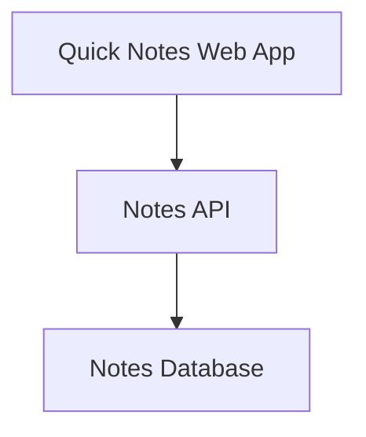
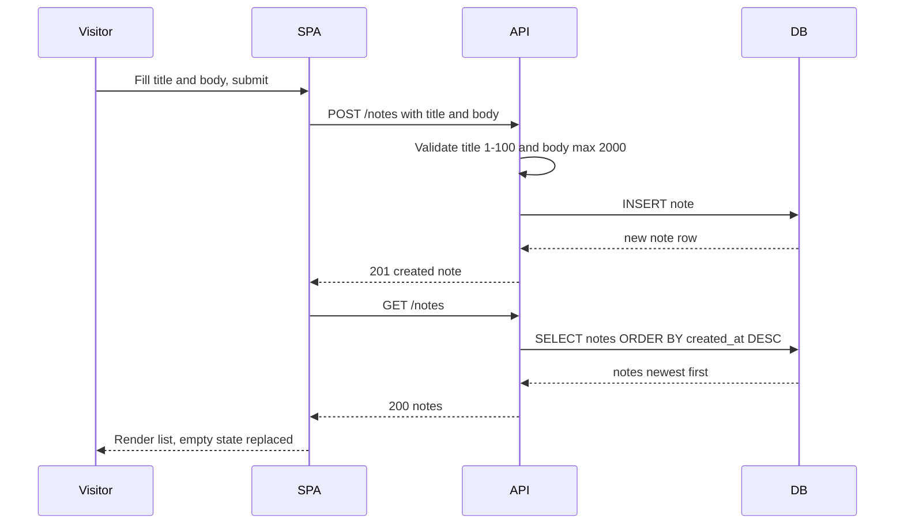
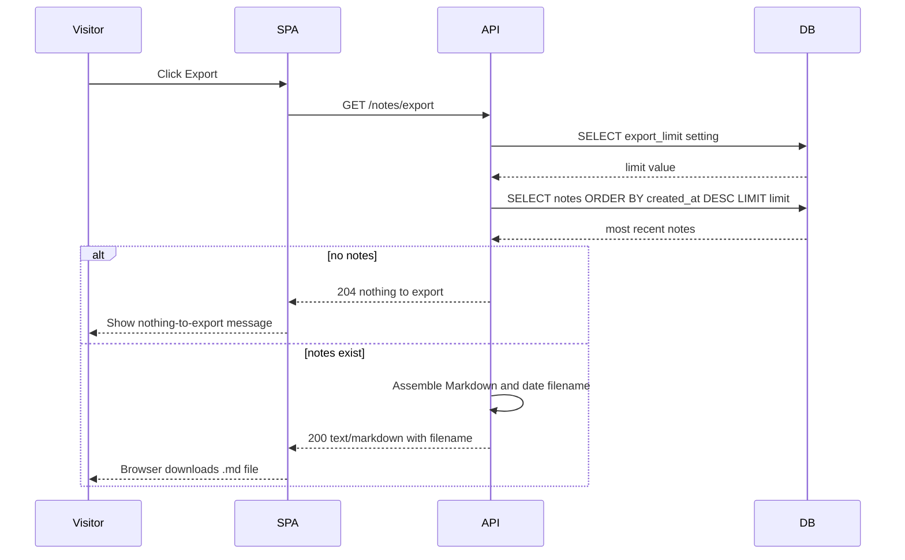
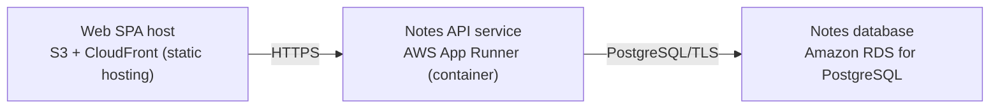

# Architecture

> Maintained by QuorQ AI SDLC. Text between `sdlc:auto` markers is regenerated; anything outside them is yours and is kept.

<!-- sdlc:auto:start narrative -->
## Overview

### ARCH-OVERVIEW · approved · source: architecture:summary

Quick Notes is a small, auth-free shared notepad: React 19 SPA, FastAPI 0.115 backend, PostgreSQL 16 database on AWS.

Version 1, approved. The SPA lets any visitor create a note (title required, max 100 chars; body max 2,000 chars), view all notes newest-first with a friendly empty state, delete after confirmation, edit a single export-limit setting (default 100), and export the most recent N notes as one date-named Markdown file downloaded in the browser. The API exposes a handful of endpoints over PostgreSQL holding two tables (notes, settings). SPA and API are deployed on separate origins on a modest AWS footprint. No sign-in by design; every visitor shares one global list (NFR-001/NFR-002 accepted risks).

**Related:** NFR-001, NFR-002

### ARCH-COMP-SPA · approved · source: architecture:component:spa

Quick Notes Web App (React 19) — the frontend single-page app.

Renders the note list (newest-first), create form with client-side length limits, delete confirmation prompt, settings area, and export button. Reads and writes via the API without page reloads, and triggers the Markdown file download in the browser.

**Related:** REQ-FEAT-LIST, REQ-FEAT-CREATE, REQ-FEAT-DELETE, REQ-FEAT-SETTINGS, REQ-FEAT-EXPORT, NFR-003

### ARCH-COMP-API · approved · source: architecture:component:api

Notes API (FastAPI 0.115) — exposes note, settings and export endpoints.

Endpoints:
- POST /notes — create a note after validating title (1-100) and body (<=2,000).
- GET /notes — list all notes newest-first (shared global list).
- DELETE /notes/{id} — permanently delete one note (no trash/undo).
- GET /notes/export — return the most recent N notes (N = export limit) as a Markdown file with a date-derived filename.
- GET /settings — return the current export-limit setting.
- PUT /settings — update the export-limit to a positive whole number.
No authentication by design.

**Related:** REQ-FEAT-CREATE, REQ-FEAT-LIST, REQ-FEAT-DELETE, REQ-FEAT-EXPORT, REQ-FEAT-SETTINGS, NFR-001

### ARCH-COMP-DB · approved · source: architecture:component:db

Notes Database (PostgreSQL 16) — stores notes and the export-limit setting.

Entities:
- notes: id, title, body, created_at.
- settings: id, export_limit, updated_at.
Serves 'newest first' and 'most recent N' as simple ordered queries (ORDER BY created_at DESC / LIMIT).

**Related:** REQ-FEAT-LIST, REQ-FEAT-EXPORT, REQ-FEAT-SETTINGS

### ARCH-CP-1 · approved · source: architecture:critical-path:create-and-list

Critical path: creating and listing a note.

Visitor submits the create form; the API validates title (1-100) and body (<=2,000), inserts a row; the SPA re-fetches the newest-first list, which replaces the empty state when present.

**Related:** REQ-FEAT-CREATE, REQ-FEAT-LIST, ARCH-COMP-SPA, ARCH-COMP-API

### ARCH-CP-2 · approved · source: architecture:critical-path:export

Critical path: exporting notes as Markdown.

Visitor clicks export; the API reads the current limit, selects the most recent N notes, assembles a Markdown document, and returns it with a date-derived filename, or tells the visitor there is nothing to export when empty.

**Related:** REQ-FEAT-EXPORT, REQ-FEAT-SETTINGS, ARCH-COMP-API

### ARCH-DEPLOY-1 · approved · source: architecture:deployment-nodes

Planned AWS deployment topology: static SPA host, containerized API, managed database.

- Web SPA host: S3 + CloudFront (static hosting), React 19 static build.
- Notes API service: AWS App Runner (container), FastAPI 0.115 on Python 3.12 / Uvicorn.
- Notes database: Amazon RDS for PostgreSQL, PostgreSQL 16.

**Related:** ARCH-COMP-SPA, ARCH-COMP-API, ARCH-COMP-DB

### ARCH-TD-FE · approved · source: architecture:tech-decision:frontend

Frontend decision: React 19 (alternatives considered: Vue, Svelte).

The approved stack. React 19 renders the few screens (list, create form, delete confirmation, settings, export button) and updates the list and prompts without a page reload (NFR-003). The export .md is produced from the API response via a Blob download in the browser.

**Related:** NFR-003, REQ-FEAT-EXPORT

### ARCH-TD-BE · approved · source: architecture:tech-decision:backend

Backend decision: FastAPI 0.115 (alternatives considered: Flask, Express).

The approved stack. Its Pydantic validation enforces the title (1-100) and body (<=2,000) rules declaratively, and the six small endpoints map cleanly to the two-sprint plan.

**Related:** REQ-FEAT-CREATE

### ARCH-TD-DB · approved · source: architecture:tech-decision:database

Database decision: PostgreSQL 16 (alternatives considered: SQLite, MySQL).

The approved stack. Notes are simple rows; 'newest first' and 'most recent N for export' are trivial ORDER BY created_at DESC / LIMIT queries, and the export limit is one settings row.

**Related:** REQ-FEAT-LIST, REQ-FEAT-EXPORT, REQ-FEAT-SETTINGS

### ARCH-TD-CLOUD · approved · source: architecture:tech-decision:cloud

Cloud decision: AWS (alternatives considered: Azure, GCP).

The approved stack. A static SPA host, one small container for the API, and a managed PostgreSQL instance give reliable, low-cost hosting for a free, low-traffic app.
<!-- sdlc:auto:end narrative -->

<!-- sdlc:auto:start building-blocks -->
## Building Block View

| ID | Name | Technology | Responsibility | Depends on |
|---|---|---|---|---|
| spa | Quick Notes Web App | React 19 | Renders the note list (newest-first), create form with client-side length limits, delete confirmation prompt, settings area, and the export button. Reads/writes via the API without page reloads and triggers the Markdown file download in the browser. | api |
| api | Notes API | FastAPI 0.115 | Exposes create/list/delete note endpoints, get/update export-limit setting, and assembles the capped Markdown export. Validates title (1-100) and body (<=2,000). No authentication by design. | db |
| db | Notes Database | PostgreSQL 16 | Stores notes (title, body, created_at) and the single export-limit setting row. Serves 'newest first' and 'most recent N' as simple ordered queries. | — |

<!-- sdlc:auto:end building-blocks -->

<!-- sdlc:auto:start runtime -->
## Runtime View

### Create and list a note

Visitor submits the create form; the API validates title (1-100) and body (<=2,000), inserts a row, and the SPA re-fetches the newest-first list which replaces the empty state when present.

- **Components:** spa, api, db
- **Modules:** notes_router, notes_service, note_model
- **Key functions:** create_note(title, body), list_notes(), validate_note(title, body)

### Export notes as Markdown

Visitor clicks export; the API reads the current limit, selects the most recent N notes, assembles a Markdown document, and returns it with a date-derived filename, or tells the visitor there is nothing to export when empty.

- **Components:** spa, api, db
- **Modules:** export_router, export_service, settings_service
- **Key functions:** export_markdown(), get_export_limit(), build_markdown(notes), filename_from_date(today)

<!-- sdlc:auto:end runtime -->

<!-- sdlc:auto:start deployment-view -->
## Deployment View

| Name | Service | Runtime | Scaling | Environment |
|---|---|---|---|---|
| Web SPA host | S3 + CloudFront (static hosting) | React 19 static build | CDN edge, static | dev |
| Notes API service | AWS App Runner (container) | FastAPI 0.115 on Python 3.12 / Uvicorn | 1 small instance, auto-scale on request count | dev |
| Notes database | Amazon RDS for PostgreSQL | PostgreSQL 16 | single db.t-class instance | dev |

| Source | Target | Protocol |
|---|---|---|
| Web SPA host | Notes API service | HTTPS |
| Notes API service | Notes database | PostgreSQL/TLS |

<!-- sdlc:auto:end deployment-view -->

<!-- sdlc:auto:start decisions -->
## Architecture Decisions

| Layer | Choice | ADR |
|---|---|---|
| Frontend | React 19 | [ADR-0001](adr/frontend.md) |
| Backend | FastAPI 0.115 | [ADR-0002](adr/backend.md) |
| Database | PostgreSQL 16 | [ADR-0003](adr/database.md) |
| Cloud | AWS | [ADR-0004](adr/cloud.md) |
<!-- sdlc:auto:end decisions -->

<!-- sdlc:auto:start links -->
## Related Documents

- [Data Model](data-model.md)
- [API Specification](api/openapi.yaml)
- [Architecture Decision Records](adr/README.md)
<!-- sdlc:auto:end links -->
