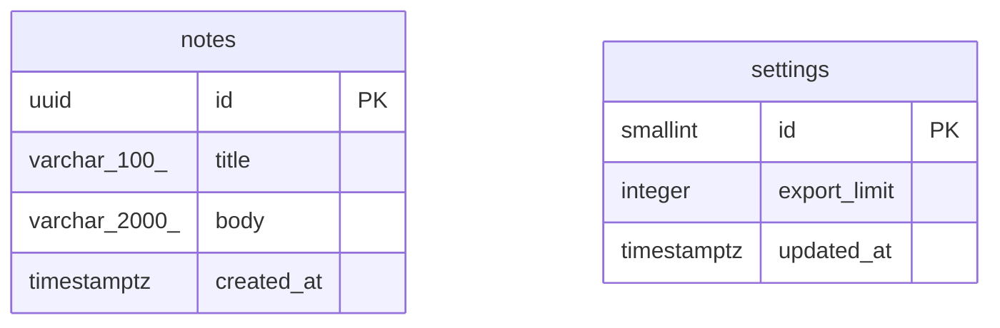

# Data Model

<!-- sdlc:auto:start entities -->
### notes

| Field | Type | PK | FK | Nullable |
|---|---|---|---|---|
| id | uuid | True | — | False |
| title | varchar(100) | False | — | False |
| body | varchar(2000) | False | — | True |
| created_at | timestamptz | False | — | False |

### settings

| Field | Type | PK | FK | Nullable |
|---|---|---|---|---|
| id | smallint | True | — | False |
| export_limit | integer | False | — | False |
| updated_at | timestamptz | False | — | False |
<!-- sdlc:auto:end entities -->

<!-- sdlc:auto:start relationships -->
_No relationships recorded._
<!-- sdlc:auto:end relationships -->

<!-- sdlc:auto:start er-diagram -->

<!-- sdlc:auto:end er-diagram -->
