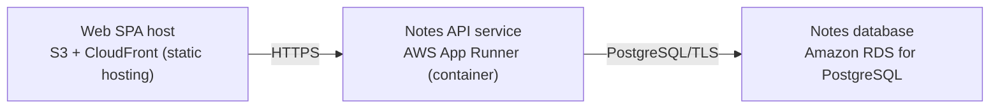

# Deployment Guide

> Maintained by QuorQ AI SDLC. Text between `sdlc:auto` markers is regenerated; anything outside them is yours and is kept.

<!-- sdlc:auto:start how-it-deploys -->
Pushes to `main` run `.github/workflows/deploy.yml`, which builds the API image (if there is a backend) and deploys the SPA to AWS Amplify. Commits touching only `docs/sdlc/**` don't deploy. Deployments can also be started from the platform's Deployment tab.
<!-- sdlc:auto:end how-it-deploys -->

<!-- sdlc:auto:start environments -->
| Name | Service | Runtime | Scaling | Environment |
|---|---|---|---|---|
| Web SPA host | S3 + CloudFront (static hosting) | React 19 static build | CDN edge, static | dev |
| Notes API service | AWS App Runner (container) | FastAPI 0.115 on Python 3.12 / Uvicorn | 1 small instance, auto-scale on request count | dev |
| Notes database | Amazon RDS for PostgreSQL | PostgreSQL 16 | single db.t-class instance | dev |
<!-- sdlc:auto:end environments -->

<!-- sdlc:auto:start live -->
**Frontend URL:** https://p92f4557adfa1.d3j61xaup4zgrx.amplifyapp.com

**Backend URL:** https://44-253-241-182.sslip.io/apps/92f4557adfa1/

**Database:** PostgreSQL · app

**Version:** e26f9462b58f

**Commit:** `e26f946`

**Finished:** 2026-11-25
<!-- sdlc:auto:end live -->

<!-- sdlc:auto:start topology -->

<!-- sdlc:auto:end topology -->
